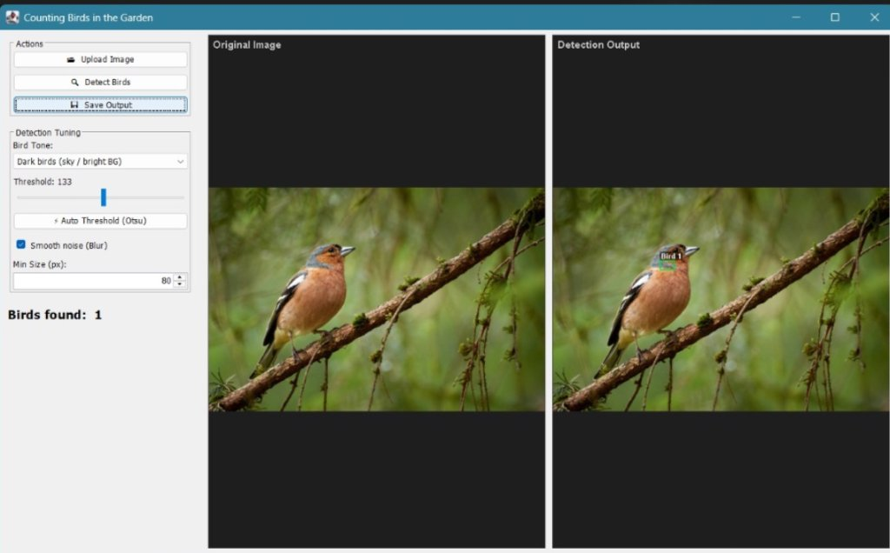

# 🐦 Counting Birds in Park Photos


[](https://www.oracle.com/java/)
[](https://imagej.net/)
[](https://junit.org/junit5/)

<p align="center">
  
</p>

## 📖 Overview
This repository implements an algorithmic computer vision application to detect, localize, and count bird populations in park and garden photography. Built for **Computer Graphics and Image Processing (CSC 360)**, the project utilizes classical digital image processing techniques grounded in the **Wilhelm Burger & Mark J. Burge (2016)** textbook. 

The application loads digital images (PNG / JPG), segments target bird candidates from complex natural backgrounds, draws green bounding boxes with unique labels, and displays the total count in a responsive Java Swing desktop interface.

---

## 🧩 The Problem
Counting targets in outdoor environments poses significant challenges due to natural clutter, fluctuating sunlight, and high-frequency textures:
- **Silhouettes vs. Plumage:** Birds flying against daylight skies are dark silhouettes, while birds in shaded foliage have bright or varied plumage.
- **Background Interference:** Leaves, grass blades, bark, and twigs create texture noise that fractures into false-positive specks under naive thresholding.
- **Linear Artifacts:** Branches, wires, and fences often get falsely segmented unless geometrical shape descriptors are enforced.

---

## ⚙️ Implemented Processing Pipeline

Our solution systematically transforms raw digital imagery into structured geometric bounding data through five sequential stages:

```
Input Image (RGB)
       │
       ▼
1. Luminance Conversion  (Y = 0.299R + 0.587G + 0.114B — Burger Ch. 14)
       │
       ▼
2. Gaussian Spatial Filter  (σ = 1.5 Low-pass smoothing — Burger Ch. 4 & 5)
       │
       ▼
3. Intensity Segmentation  (Otsu Between-Class Variance Maximization — Burger Ch. 10 & 11)
       │  └─ Dual-Polarity: Dark Silhouettes on Sky OR Bright Plumage on Foliage
       ▼
4. Connected-Component Analysis  (4-Connectivity Flood-Fill Equivalence — Burger Ch. 10)
       │
       ▼
5. Morphological & Shape Filtering  (Area + Circularity C >= 0.15 — Burger Ch. 13)
       │  └─ Rejects long skinny twigs, wires, and sensor specks
       ▼
Output: Annotated Image with Green Bounding Boxes + Total Bird Count
```

### 1. Image Pre-processing and Filtering 🧽
* **Luminance Reduction:** Converts 24-bit RGB to 8-bit grayscale using human spectral sensitivity weighting:
  $$Y = 0.299R + 0.587G + 0.114B$$
* **Gaussian Spatial Smoothing:** Applies a 2D Gaussian kernel ($\sigma = 1.5$) to attenuate high-frequency foliage and bark textures without distorting object contours.

### 2. Image Segmentation ✂️
* **Dual-Polarity Thresholding:** Supports segmentation of both dark silhouettes (daylight sky) and bright plumage (shaded canopy).
* **Automated Otsu Thresholding:** Automatically maximizes between-class variance $\sigma_B^2(t)$ across the grayscale histogram:
  $$\sigma_B^2(t) = \omega_0(t)\omega_1(t) \cdot [\mu_0(t) - \mu_1(t)]^2$$

### 3. Morphological Cleanup & Shape Descriptors 🧹
* **Compactness / Circularity Metric:** Evaluates region isoperimetric quotient to distinguish compact bird bodies from long linear branches:
  $$\text{Circularity} = \frac{4\pi \cdot \text{Area}}{\text{Perimeter}^2}$$
  Candidates with circularity $< 0.15$ (thin branches, wires, fences) are automatically discarded.
* **Area Filtering:** Rejects microscopic noise ($< \text{minArea}$) and large background regions ($> \text{maxArea}$).

### 4. Region Counting and Analysis 🧮
* **Connected-Component Labeling:** Uses ImageJ's `ParticleAnalyzer` (with explicit threshold state registration) to discover 4-connected topological components.
* **Java2D Visual Overlay:** Overlays anti-aliased green bounding rectangles (stroke = 2px) and bold white "Bird N" badges with dark translucent backing labels onto an RGB copy of the original image.

---

## 🏗️ Architecture & Project Structure

The project is structured under `endsem_project/` using clean Object-Oriented principles:

```
CSC360-Group10/
├── README.md                             # Repository overview and documentation
├── Neon Bird Vision Analysis Collage.png # Project visualization banner
└── endsem_project/                       # Application root
    ├── pom.xml                           # Maven project configuration
    ├── run.bat                           # One-click desktop launcher
    ├── mvnw.cmd                          # Maven wrapper script
    └── src/
        ├── main/java/
        │   ├── Main.java                 # Desktop bootstrap & EDT initialization
        │   ├── detection/
        │   │   ├── BirdCandidate.java    # Immutable domain model (ID, bounds, area)
        │   │   ├── BirdCounter.java      # Java2D annotation overlay & tally service
        │   │   └── BirdDetector.java     # 5-stage vision pipeline & Otsu algorithm
        │   ├── ui/
        │   │   ├── BirdCountingGUI.java  # Interactive Swing GUI with tuning sidebar
        │   │   └── ImagePanel.java       # Bilinear aspect-ratio rendering canvas
        │   └── utils/
        │       └── ImageUtils.java       # File I/O bridge (ImageIO & FileSaver)
        └── test/java/
            ├── BirdCounterTest.java      # Annotation and tally unit tests
            ├── BirdDetectorTest.java     # Segmentation, Otsu, blur, and circularity tests
            └── ImageUtilsTest.java       # Image loading, saving, and conversion tests
```

---

## 🚀 How to Run the Application

### Prerequisites
- **Java 21 LTS** (or Java 17+)
- ImageJ 1.54f dependency (resolved automatically via Maven)

### Option 1: One-Click Desktop Launcher (Windows)
Navigate to `endsem_project/` and double-click:
```powershell
.\endsem_project\run.bat
```

### Option 2: Run via Terminal
```powershell
cd endsem_project
java -cp "target\classes;%USERPROFILE%\.m2\repository\net\imagej\ij\1.54f\ij-1.54f.jar" Main
```

### Option 3: Build & Package with Maven
```bash
cd endsem_project
./mvnw clean package
java -jar target/bird-counting-1.0.0.jar
```

---

## 🖥️ Interactive GUI Controls

The desktop interface allows real-time tuning for any outdoor photo:
- **Bird Tone Dropdown:** Toggle between `Dark birds (sky / bright BG)` and `Bright birds (dark / shade BG)`.
- **Threshold Slider ($0 - 255$):** Live sensitivity adjustment with instant visual feedback.
- **⚡ Auto Threshold (Otsu):** Automatically analyzes the histogram and sets the optimal threshold.
- **Smooth foliage noise (Blur):** Toggles Gaussian pre-filtering.
- **Ignore skinny twigs (Circularity):** Filters out thin branches and wire lines.
- **Show Binary Mask (B&W):** Displays the raw black-and-white segmented mask for algorithmic inspection.
- **Min Size (pixels):** Interactive spinner to filter out small background debris ($10 - 50,000\text{ px}$).

---

## 🧪 Automated Testing

All core components are validated with **32 comprehensive JUnit 5 unit tests**:

```powershell
cd endsem_project
mvn test
```

- **`BirdDetectorTest` (16 tests):** Validates black/white frames, threshold boundary clamping, dual-polarity segmentation, Otsu bimodal histograms, Gaussian smoothing, and circularity filtering.
- **`BirdCounterTest` (10 tests):** Verifies count tally accuracy, null safety, bounds immutability, and Java2D annotation dimensions.
- **`ImageUtilsTest` (6 tests):** Validates image reading, format conversion, and PNG export validation.

---

## 📚 References & Literature

1. **Burger, W., & Burge, M. J. (2016).** *Digital Image Processing: An Algorithmic Introduction Using Java* (2nd ed.). Springer.
   - Chapter 4 & 5: Linear and Non-linear Spatial Filters (Gaussian smoothing).
   - Chapter 10 & 11: Global and Automatic Thresholding (Otsu's method).
   - Chapter 10: Region Labeling and Connected Components (4-connectivity).
   - Chapter 13: Morphological Shape Descriptors (Compactness, Area, Bounding Boxes).
   - Chapter 14: Color Image Processing (Luminance weighting).
2. **Schneider, C. A., Rasband, W. S., & Eliceiri, K. W. (2012).** NIH Image to ImageJ: 25 years of image analysis. *Nature Methods*, 9(7), 671-675.
